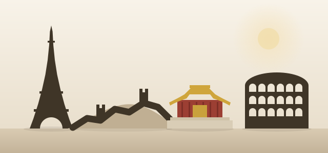

# dsh-landmarks-3d

A DeepSeek Harness plugin. It adds one entry to the left sidebar; the entry opens a
full page with four world landmarks rendered as interactive 3D models.



| Landmark | Location |
| --- | --- |
| Eiffel Tower | Paris, France |
| Great Wall | Northern China |
| Forbidden City | Beijing, China |
| Colosseum | Rome, Italy |

## What it does

- **Left sidebar entry** — registered into `sidebar.panellist` with `id: landmarks-3d`,
  and the matching `main` panel key renders the page. The icon is a hand-drawn SVG
  Eiffel Tower, so no image asset is downloaded.
- **Real 3D, no dependencies** — every model is built procedurally from triangles at
  load time and drawn by a small hand-written WebGL renderer inside `client.js`.
  No `three.js`, no CDN script, no build step.
- **Interaction** — drag to orbit, wheel or two-finger pinch to zoom, `+`/`-`/arrow keys
  on the focused canvas, double-click to reset the camera, and a toggle that stops or
  starts the slow auto-rotation. A new landmark starts rotating only after the gesture
  pauses, and motion follows `prefers-reduced-motion`.
- **Themed** — surfaces and text use `--dsw-alias-*` tokens, so light and dark themes
  both work; only the artwork carries its own stone/bronze palette.

## Models

Each model is generated from a parametric description rather than loaded from a file:

- **Eiffel Tower** — four lattice legs converging through three stages, four base
  arches, three platforms, the top lantern and antenna mast.
- **Great Wall** — a sinuous ridge line with a crenellated wall extruded along it,
  watchtowers, and a scatter of conifers.
- **Forbidden City** — perimeter wall with corner towers, three-tier marble terrace,
  a double-eave main hall with upturned eaves, and side halls.
- **Colosseum** — 36 bays on an elliptical plan, three arcade storeys plus attic,
  a stepped cavea, and a collapsed sector of the outer ring — about a third of it — so
  the ruin reads as a ruin.

## Files

```
package.json        manifest: bundle patch + client section
cordis.patch.yml    inserts the host plugin row
index.js            host half (no server work; the client owns rendering)
client.js           client module: models, WebGL renderer, sidebar icon, page
icon.svg            sidebar icon
locale/en.json      plugin manager metadata (English)
locale/zh.json      plugin manager metadata (Chinese)
docs/DETAIL.md      plugin detail page (English)
docs/DETAIL.zh.md   plugin detail page (Chinese)
docs/preview.svg    preview illustration used by the detail page
```

## Requirements

- DeepSeek Harness with the web client (the plugin targets the `sidebar.panellist` and
  `main` slots).
- A WebGL-capable renderer; without one the panel shows a message instead of a canvas.

## Install

```
plugin_manager action: install_bundle target: <this directory>
```

After installing, refresh the page once so the client half loads: the sidebar gains an
icon (a small Eiffel Tower) that opens the panel.

## Controls

| Action | Input |
| --- | --- |
| Orbit | drag with the pointer |
| Zoom | wheel, two-finger pinch, or `+` / `-` with the canvas focused |
| Rotate with keys | arrow keys with the canvas focused |
| Reset camera | double-click, or the "Reset view" pill |
| Stop auto-rotation | the "Auto-rotate" pill |
| Recover from a WebGL failure | the message inside the stage says so; the tabs stay inert |
