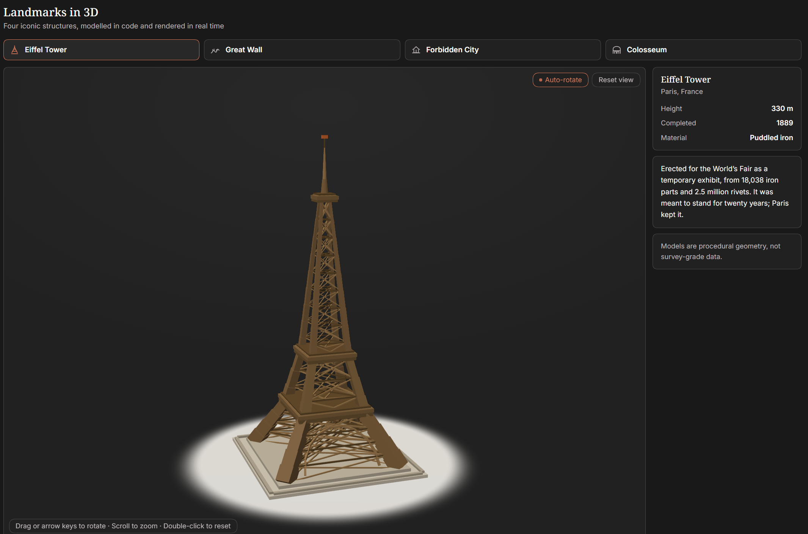

# dsh-landmarks-3d

[English](README.md) · 简体中文

一个 DeepSeek Harness 插件。它在左侧边栏新增一个入口，点开后是一整页，用可交互的 3D 模型展示四座世界地标。



在面板里实时渲染。上图是深色主题，浅色主题同样适配。

| 地标 | 位置 |
| --- | --- |
| 埃菲尔铁塔 | 法国 · 巴黎 |
| 万里长城 | 中国 · 北方 |
| 紫禁城 | 中国 · 北京 |
| 罗马斗兽场 | 意大利 · 罗马 |

## 它做了什么

- **左侧边栏入口** —— 注册进 `sidebar.panellist`，`id: landmarks-3d`；同名的 `main` 面板
  承接整页内容。图标是手写的 SVG 铁塔，不下载任何图片资源。
- **真正的 3D，零依赖** —— 每个模型都在加载时用三角形程序化生成，由 `client.js` 里一个
  手写的 WebGL 渲染器绘制。没有 three.js，没有 CDN 脚本，没有构建步骤。
- **交互** —— 拖动旋转，滚轮或双指捏合缩放，canvas 聚焦后可用 `+`/`-` 与方向键，双击复位
  视角；另有开关控制缓慢的自动旋转（手势后暂停，并遵循 `prefers-reduced-motion`）。
- **跟随主题** —— 面板与文字的底色、边框、文字色全部取自 `--dsw-alias-*` 主题令牌，浅色与
  深色都能用；只有模型本身带有自己的石材 / 青铜色调。

## 四个模型

每个模型都由参数化描述生成，而不是从文件加载：

- **埃菲尔铁塔** —— 四条格构塔腿经三段收拢，底座四拱、三层平台、顶部灯室与天线桅杆。
- **万里长城** —— 起伏的山脊线，沿脊扫掠出带垛口的墙体，配敌楼与散落的松树。
- **紫禁城** —— 宫墙与四角楼、三层汉白玉台基、重檐起翘的主殿、两侧配殿。
- **罗马斗兽场** —— 椭圆平面的 36 个开间，三层拱廊加顶层实墙、阶梯看台，以及外环约三分之一
  的坍塌断面，让废墟读起来像废墟。

## 在另一台机器 / 全新的 DeepSeek Harness 上安装

**前提**：带有 Web 客户端的 DeepSeek Harness（插件依赖 `sidebar.panellist` 与 `main` 两个
插槽），以及可用的 WebGL。除此之外不需要任何东西——包本身零依赖、无构建步骤，离线也能装。

### 1. 把插件放到本机

这是一个"目录型 bundle"，DSH 从文件夹安装它，而不是从 npm 安装：

```bash
git clone https://github.com/YunFengyi/dsh-landmarks-3d.git
```

在仓库页面用 **Code → Download ZIP** 下载解压，效果相同。

### 2. 安装

两种方式，结果一样：都装进当前 profile，对所有会话生效，重启后仍在。

- **在网页界面里装**：打开左侧边栏的 **Plugins**，选择 **Add plugin**，然后选中刚克隆出来的
  `dsh-landmarks-3d` 文件夹。（这个入口安装的是本地目录。）
- **在会话里让 agent 装**：把绝对路径告诉它，例如"装一下
  `D:\code\dsh-landmarks-3d` 这个插件"，它会调用 `plugin_manager` 的
  `action: install_bundle`，`target` 就是这个目录。

### 3. 刷新一次页面

渲染那一半是客户端模块，所以要让 Harness 页面重新加载一次。左侧边栏会多出一个图标（一座小
铁塔，排在自带面板之后），点开就是整页。

如果图标没出现：打开 **Plugins**，确认 `dsh-landmarks-3d` 这一行是启用状态，再刷新一次。

### 更新与卸载

```bash
cd dsh-landmarks-3d && git pull   # 然后刷新页面
```

卸载：**Plugins** 里找到 `dsh-landmarks-3d` 这一行删掉；或让 agent 调用
`plugin_manager` `action: remove_bundle`，`target: dsh-landmarks-3d`。

## 操作

| 动作 | 输入方式 |
| --- | --- |
| 旋转 | 按住拖动 |
| 缩放 | 滚轮、双指捏合，或 canvas 聚焦后 `+` / `-` |
| 键盘旋转 | canvas 聚焦后按方向键 |
| 复位视角 | 双击，或点「复位视角」 |
| 停止自动旋转 | 点「自动旋转」 |
| WebGL 不可用时 | 画面区域会给出提示，四个页签同时置灰 |

## 文件

```
package.json        manifest：bundle patch + client 段
cordis.patch.yml    插入 Host 侧插件行
index.js            Host 半边（无服务端逻辑，渲染全在 client）
client.js           Client 模块：模型、WebGL 渲染器、侧栏图标、整页
icon.svg            侧栏图标
locale/en.json      插件管理器元数据（英文）
locale/zh.json      插件管理器元数据（中文）
docs/DETAIL.md      插件详情页（英文）
docs/DETAIL.zh.md   插件详情页（中文）
docs/screenshot.png README 首图（面板真实渲染）
docs/preview.svg    详情页用的预览插图
test/verify-panel.mjs     静态校验：槽位、翻译 key、可访问性、样式覆盖
test/verify-geometry.mjs  模型几何、真实比例、取景是否框得下
CONTRIBUTING.md     提交格式、分支命名、怎么跑校验
```

## 测试

不需要浏览器，也不需要装依赖——两个脚本要么把 `client.js` 当文本读，要么在 Node 里把模型
重新建出来，再用渲染器那套矩阵做投影：

```
npm test
```

`verify-panel.mjs` 用假的 `__ModuleLoader__` 加载模块，拿可记录的 `ctx` 调 `apply()`，
断言两处槽位注册共用同一个 id、`<style>` 已挂载、每个 `t()` key 在中英两种语言里都能解析、
每个渲染出来的 className 都有对应样式。`verify-geometry.mjs` 建出四个模型，检查三角形数据、
与真实建筑的比例，并确认自动取景把整座模型框在视野内。

## 技术说明

- 没有运行时依赖：`client.js` 只用 Harness 客户端内置的 `React` 与 `ctx`，不 import 任何
  Harness 客户端包，也不访问网络。
- 相机取景由每个模型的包围盒推导（含近角透视修正），所以 48 单位宽的长城和 21 单位高的铁塔
  都能自动框好，换模型不用手调参数。
- 已知限制：需要 WebGL；模型是示意性几何，不是测绘级精度；触屏缩放必须用两根手指。
